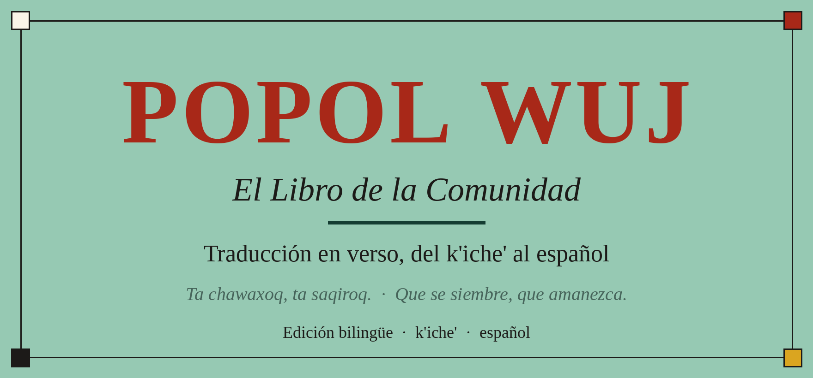
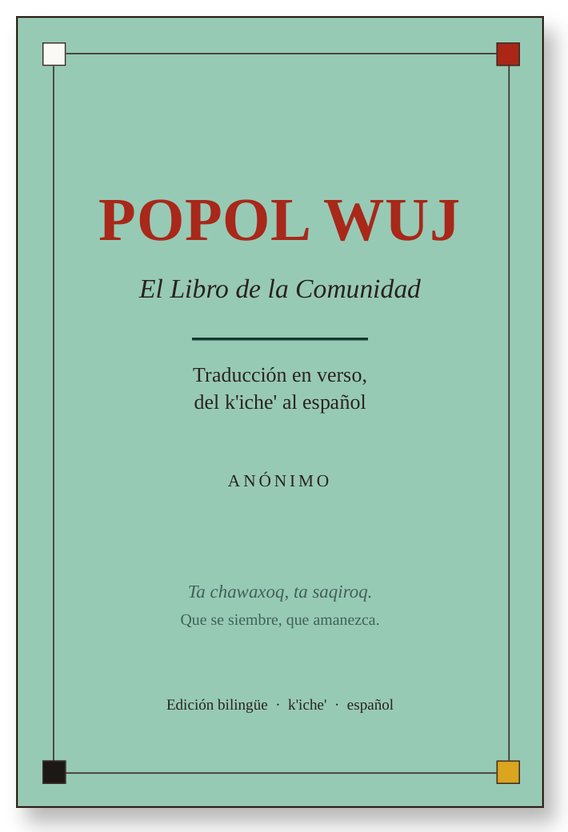
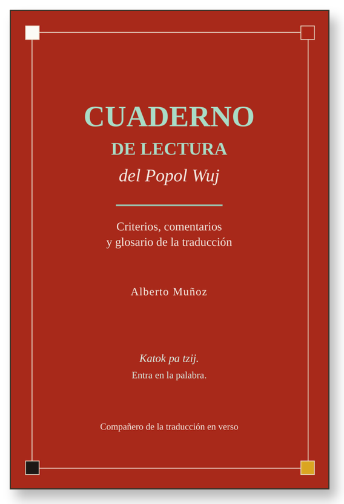
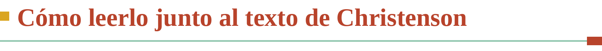
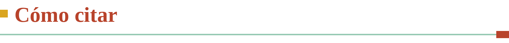

  

  <b>El Popol Wuj completo, en verso, con el k'iche' (lengua maya de Guatemala) y el español frente a frente.</b> 
  Cada verso k'iche' lleva al lado su traducción, y los números de verso son los de Allen J. Christenson. 
  <i>The complete Popol Wuj in verse: K'iche' Maya and Spanish, side by side. Free to read and download.</i>

<table align="center">
  <tr>
    <td align="center" valign="top" width="50%">
       
       
      
    </td>
    <td align="center" valign="top" width="50%">
       
       
      
    </td>
  </tr>
</table>

  <b>Gratis</b> · Popol Wuj, edición 172 · Cuaderno de lectura, edición 122 · Traducción y notas con licencia CC BY 4.0 
  Los EPUB no se abren dentro de GitHub: se bajan con su botón y se leen en Apple Books, Kindle, Calibre o la app de libros del celular. 
  Texto k'iche': Allen J. Christenson, usado con su permiso · K'iche' text by Allen J. Christenson, used by permission (<a href="#in-english">credits in English</a>).

El texto k'iche' de este libro es el de Allen J. Christenson, y **sus números de verso son los mismos**. Por eso se pueden abrir los dos libros a la vez y seguir el mismo pasaje en ambos.

1. Abre el PDF de Christenson en su página oficial: **<https://www.mesoweb.com/publications/Christenson/PV-Literal.pdf>**
   (es suyo y está en Mesoweb; aquí no se copia).
2. Abre en otra ventana [`Popol_Wuj.pdf`](Popol_Wuj.pdf).
3. Pon las dos ventanas lado a lado (en el computador: arrastra cada una a un lado de la pantalla).
4. Busca el mismo número de verso en las dos. Christenson imprime un número **cada diez versos**; para hallar uno intermedio se cuenta hacia abajo desde el número anterior.

El PDF de Christenson incluye además su traducción literal al inglés, que así queda al lado de la traducción española.

| Archivo | Qué es |
|---|---|
| [`Popol_Wuj.pdf`](Popol_Wuj.pdf) · `.epub` | El libro completo, con tapa. El EPUB es para celulares y lectores digitales. |
| [`Cuaderno_de_lectura.pdf`](Cuaderno_de_lectura.pdf) · `.epub` | El *Cuaderno de lectura del Popol Wuj*: criterios de la traducción, notas, glosario y bibliografía. |
| [`LICENSE.md`](LICENSE.md) | Qué se puede hacer con la traducción y las notas. |
| [`NOTICE-Christenson.md`](NOTICE-Christenson.md) | El texto k'iche': de quién es y bajo qué permiso se reproduce. |
| [`CITATION.cff`](CITATION.cff) | La ficha para citar este libro. |

**The complete Popol Wuj in verse, with the K'iche' Maya text and a Spanish translation facing each other.** Verse numbers are those of Allen J. Christenson. Free to read and download: PDF and EPUB, plus a *Cuaderno de lectura* (reading notebook, in Spanish) with the translation criteria, notes and glossary.

**Credits**

- **K'iche' text:** K'iche' text in modern orthography transcribed by Allen J. Christenson, from *Popol Vuh: Literal Poetic Version. Translation and Transcription* (electronic edition, Mesoweb, 2007). Used by permission of the author. The K'iche' text remains under his copyright and is not covered by the CC BY license. See [`NOTICE-Christenson.md`](NOTICE-Christenson.md).
- **Spanish translation, notes and Cuaderno de lectura:** Alberto Muñoz, licensed under CC BY 4.0 (see [`LICENSE.md`](LICENSE.md)).
- **Reading alongside Christenson's edition:** the verse numbers are the same as in his PDF, which is on his official Mesoweb page (not hosted here): <https://www.mesoweb.com/publications/Christenson/PV-Literal.pdf>
- **AI assistance:** the translation was made with the assistance of Claude, an AI tool by Anthropic, for cross-checking and review. Selection, interpretation and final responsibility are the author's.

Esta edición sigue estrictamente la numeración de los versos de Christenson, tal como él la imprime. La explicación completa está en el Cuaderno de lectura, en «Numeración de los versos y cotejo con Christenson». Quien tenga una edición anterior del libro (anterior a la 171) puede pasar sus números a los de Christenson con la tabla publicada en Zenodo: <https://doi.org/10.5281/zenodo.24445204>

- **La traducción española, las notas, el Cuaderno de lectura y el glosario** se publican con la licencia **Creative Commons Atribución 4.0 Internacional (CC BY 4.0)**: se pueden copiar, repartir y adaptar, también con fines comerciales, siempre que se mencione la autoría. Ver [`LICENSE.md`](LICENSE.md).
- **El texto k'iche'** (la columna de la izquierda) **no entra en esa licencia.** Es la transcripción de Allen J. Christenson y sigue bajo su copyright; se reproduce con su permiso. Ver [`NOTICE-Christenson.md`](NOTICE-Christenson.md).

> Muñoz, Alberto. *Popol Wuj. El Libro de la Comunidad. Traducción en verso, del k'iche' al español.* Edición bilingüe. 2026.
> K'iche' text in modern orthography transcribed by Allen J. Christenson, from *Popol Vuh: Literal Poetic Version. Translation and Transcription* (electronic edition, Mesoweb, 2007). Used by permission of the author.

Para citar un pasaje, se da el número de verso de Christenson (por ejemplo, «vv. 2436-2448»).

- Kindle y pasta blanda en Amazon: [Popol Wuj](https://www.amazon.com/dp/B0HRN4JP1T) · [Cuaderno de lectura](https://www.amazon.com/dp/B0HRM1GFSY). Es el mismo contenido. Amazon no permite libros gratuitos en Kindle, por eso allá tienen precio; aquí se puede leer y bajar sin pagar.
- Estudio relacionado en Zenodo: *Los dos Popol Wuj: la ley de Ixkik' y el abrazo de Tojil*, <https://doi.org/10.5281/zenodo.23992975>.

La traducción se hizo con la asistencia de Claude, herramienta de inteligencia artificial de Anthropic, para cotejar y revisar. La selección, la interpretación y la responsabilidad final son del autor.

Abre un «Issue» en este repositorio (pestaña **Issues**) y cuéntalo, con el número de verso.
